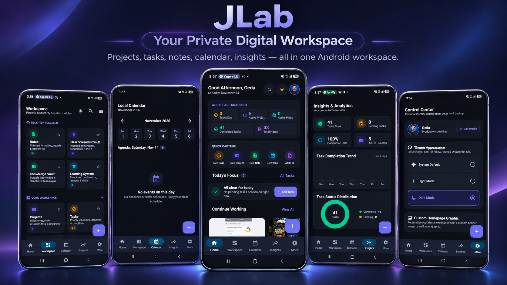
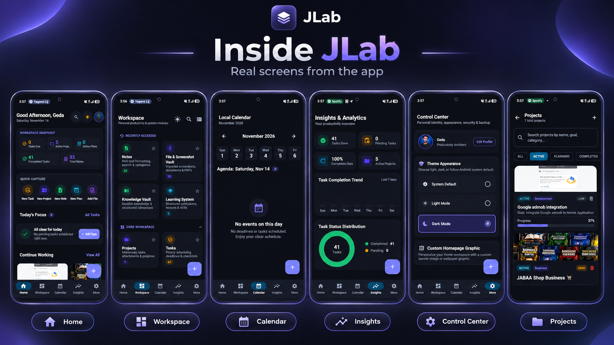

<div align="center">




</div>

<div align="center">

# JLab — Your Private Digital Workspace

**One Android app for projects, tasks, notes, plans, knowledge and personal progress.**


</div>

---

## A workspace built around how you actually work

**JLab** combines productivity, personal organization and knowledge management into one native Android application. It is designed around a practical cycle:

**Capture → Organize → Plan → Execute → Track → Review**

Instead of moving between scattered notes, task lists and planning tools, JLab brings everyday workflows into a unified, private workspace.

## Visual overview



*The showcase panels above are based on real JLab app screenshots supplied by the developer. The launcher icon is loaded directly from the existing Android project. Existing SVG graphics remain available in the assets folder.*

## What you can do

| Workspace | Capabilities reflected in this project |
|---|---|
| **Projects & tasks** | Create project workspaces, manage tasks, priorities, progress and related details. |
| **Notes & rich text** | Write and edit notes, organize information and work with formatting. |
| **Files Vault** | Keep attachments, documents and images in a dedicated local workspace. |
| **Plans, goals & habits** | Manage personal commitments, goals, routines and progress. |
| **Calendar & reminders** | Plan dates and use local Android notifications. |
| **Knowledge & prompt library** | Organize reference material and reusable prompts. |
| **Business & learning** | Track business ideas, learning plans, courses and study notes. |
| **Social content** | Organize content ideas and production tasks. |
| **Insights & reviews** | Look at progress and reflect on completed work. |
| **Settings & personalization** | Customize parts of the workspace and local preferences. |
| **Backup & restore** | Local export and restoration tools implemented in the Android project. |

*Available features and behavior can differ between the APK files included in this repository; the source tree is the reference for the currently committed implementation.*

## Application structure

The repository contains a substantial Android source tree, including:

```text
app/src/main/
├── AndroidManifest.xml
└── java/com/example/
    ├── MainActivity.kt
    ├── JlabApplication.kt
    ├── data/
    │   ├── local/               # Room database, DAO, entities, preferences
    │   └── repository/          # Data access and business logic
    ├── receiver/                # Boot, reminder and notification actions
    ├── service/                 # Backup, notifications and reminder scheduling
    └── ui/
        ├── components/          # Reusable Compose UI
        ├── screens/             # Projects, notes, tasks, files, learning, etc.
        └── theme/               # App design system
```

## Engineering

| Layer | Technology |
|---|---|
| Language | Kotlin |
| User interface | Jetpack Compose / Material 3 |
| Local persistence | Room / SQLite |
| Preferences | Android DataStore |
| Notifications | Android notification channels, broadcasts and local scheduling |
| Data backup | On-device ZIP-based backup and restore implementation |
| Design approach | Mobile-first, offline-oriented, with reusable screens and components |

JLab is designed to keep core information on the device rather than requiring an online account to organize daily work. Review `AndroidManifest.xml` and each build configuration for the exact permissions of your chosen APK.

## Build from source

For a compatible Java/Android SDK and Gradle environment:

```bash
./gradlew :app:assembleDebug
```

Then look in `app/build/outputs/apk/debug/`. Before distributing a build, check the manifest, application ID, signing configuration and Android compatibility.

### APK files already in this repository

- `JLab_v3.apk`
- `Jlab.apk`
- `Jlab-debug.apk`
- `Jlab_v2_source.zip`

These existing artifacts are **preserved, not replaced or deleted**. Names are not proof of matching build versions, signatures or release readiness; verify them before installing or sharing.

## Privacy and safety

JLab contains personal notes, projects and files. Keep backups securely, verify the actual source and Android permissions before installing an APK, and avoid sharing exported user data.

## Why I built it

JLab is a personal organizer developed by **Geda Taye**, a self-taught Android and web developer from Ethiopia. It reflects a real need: manage multiple software projects, ideas and daily work from a smartphone without juggling disconnected tools.

Other projects: [NONOX on Google Play](https://play.google.com/store/apps/details?id=com.nonox.app) · [JABAA Shop](https://jabashop.store)

## Connect

[GitHub](https://github.com/geda21) · [LinkedIn](https://www.linkedin.com/in/geda-taye-a60b403ba)

---

**Repository note:** Source code and APKs are provided here as project materials. No open-source license is implied unless a separate license file grants one.
